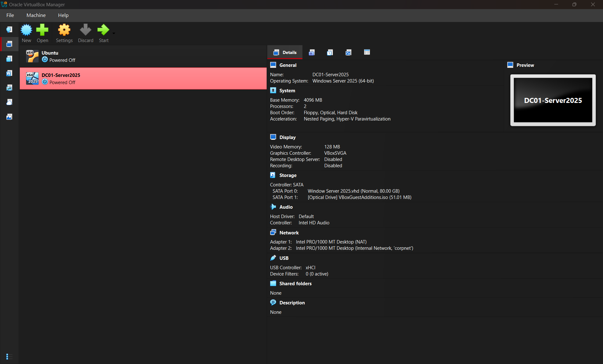
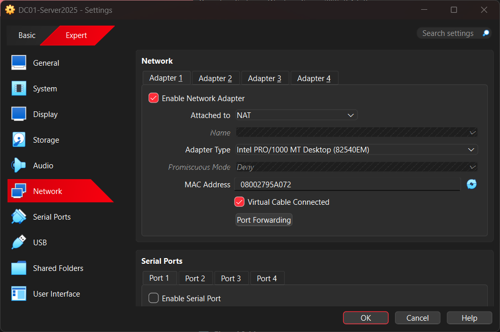
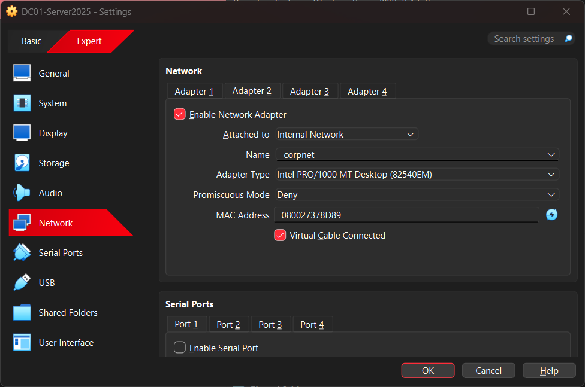
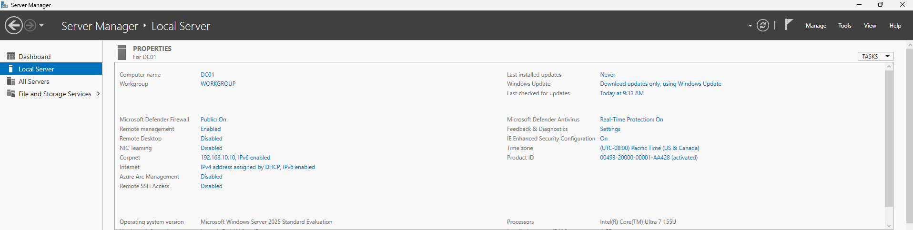
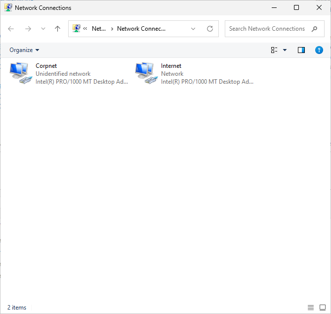
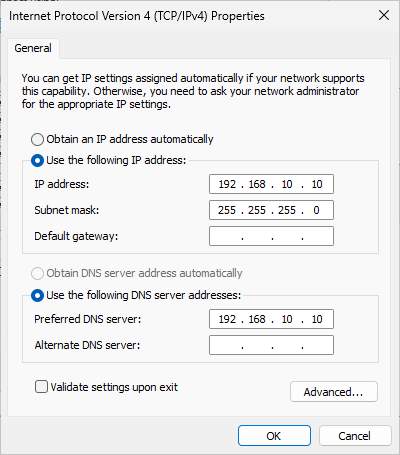
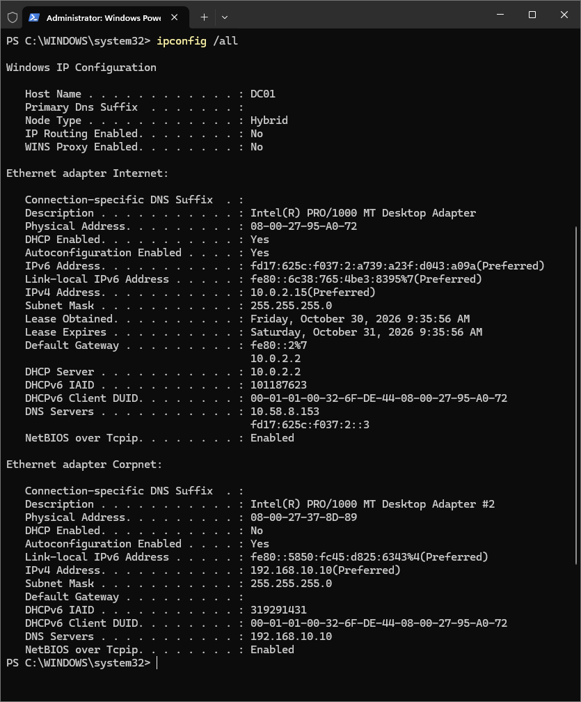
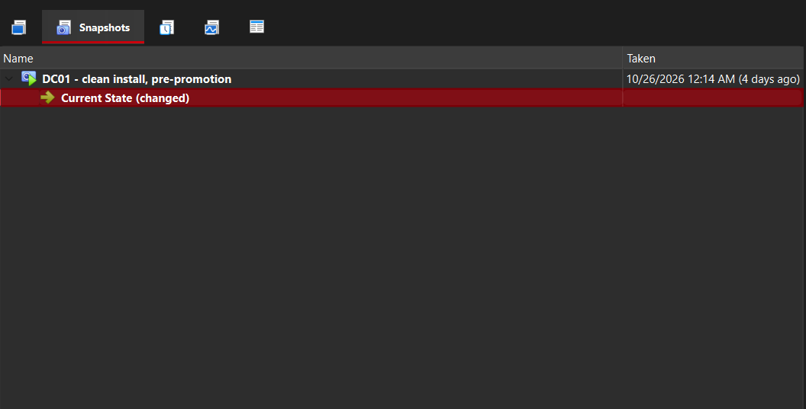

# Phase 2: Windows Server VM Build

## Goal

I built a virtual machine in Oracle VirtualBox, a Type 2 (hosted) hypervisor, and installed Windows Server 2025 on it with the name DC01 and a static IP address. This server will become the domain controller for my Active Directory lab, so it needs a fixed name and address that every other computer on the network can reliably find.

## Environment

- Hypervisor: Oracle VirtualBox

- OS: Windows Server 2025 Evaluation (Desktop Experience)

- Resources: 4 GB RAM, 2 CPUs, 60 GB disk

- Network: Adapter 1 NAT (internet), Adapter 2 Internal Network "corpnet"

## Steps

1. Created a new VM named DC01 in VirtualBox with 4 GB RAM, 2 CPUs and a 60 GB dynamically allocated disk, and skipped unattended installation so I could do the install manually.

2. Configured two network adapters: Adapter 1 as NAT for internet access and Adapter 2 as an Internal Network named "corpnet" for the private lab network.

3. Installed Windows Server 2025 Standard Evaluation (Desktop Experience) and set the Administrator password.

4. Installed VirtualBox Guest Additions for screen resizing and copy/paste, then restarted.

5. Renamed the server to DC01 before promoting it to a domain controller, since renaming afterward causes problems.

6. Renamed the adapters to "Internet" and "Corpnet" and set a static IP of 192.168.10.10 (subnet mask 255.255.255.0, DNS pointing to itself) on Corpnet.

7. Verified the settings with `ipconfig /all`.

8. Took a VirtualBox snapshot named "DC01 - clean install, pre-promotion" as a rollback point.

## Why

- Two adapters: Adapter 1 (NAT) gives the server internet access through my host PC for updates and downloads. Adapter 2 (Internal Network) is an isolated private network that only my lab VMs can use, which keeps the lab separate from my home network and lets the client and server talk to each other.

- Static IP: By default, addresses are assigned automatically and can change. A domain controller needs a fixed address (192.168.10.10) because every other computer in the domain will look for it there.

- DNS points to itself: Active Directory relies on DNS to let computers find the domain controller. DC01 will run the DNS service itself, so its DNS setting points to its own address. Client computers will later use this same address as their DNS server.

## Problems and fixes

Problem: After installing Guest Additions, the screen resized correctly at first. But each time I started the server again, the window shrank back to a small size.

Fix: I used the View menu in VirtualBox and adjusted the auto-resize and virtual screen options until the display returned to the correct size. 

Lesson: Display issues in a VM can come from Guest Additions or the virtual graphics settings, and the View menu is a quick way to correct them while troubleshooting.

## Screenshots

   
  <em>Figure 1: DC01 VM summary showing 4 GB RAM, 2 CPUs and a 60 GB disk.</em> &nbsp;

   
  <em>Figure 2: Adapter 1 set to NAT for internet access.</em> &nbsp;

   
  <em>Figure 3: Adapter 2 set to Internal Network "corpnet" for the private lab network.</em> &nbsp;

   
  <em>Figure 4: Server Manager showing the server renamed to DC01.</em> &nbsp;

   
  <em>Figure 5: Network adapters renamed to Internet and Corpnet.</em> &nbsp;

   
  <em>Figure 6: Static IP 192.168.10.10 on Corpnet, with DNS pointing to itself.</em> &nbsp;

   
  <em>Figure 7: <code>ipconfig /all</code> output confirming the network settings.</em> &nbsp;

   
  <em>Figure 8: Snapshot "DC01 - clean install, pre-promotion" kept as a rollback point.</em> &nbsp;

