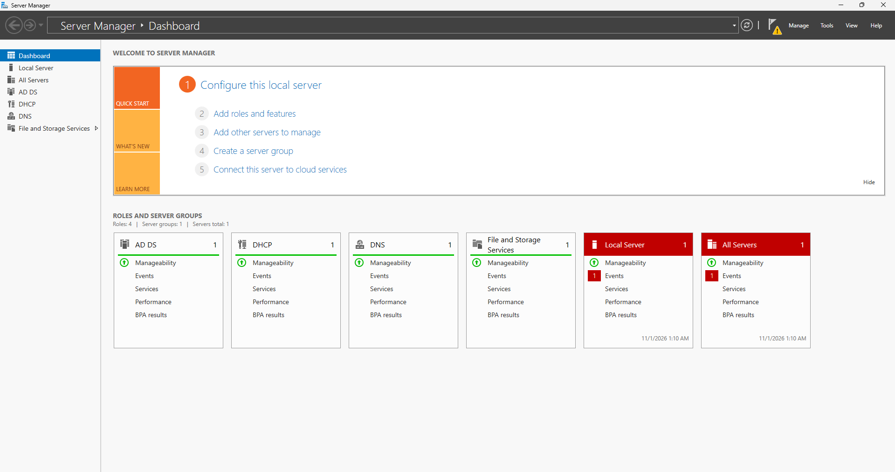
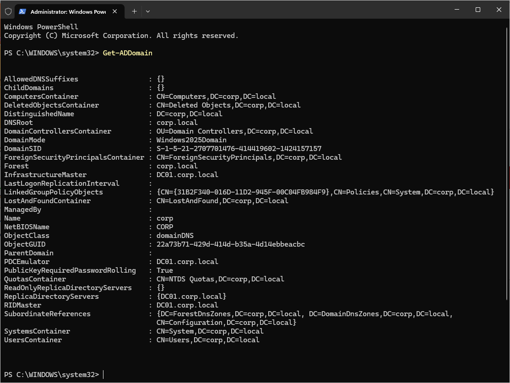
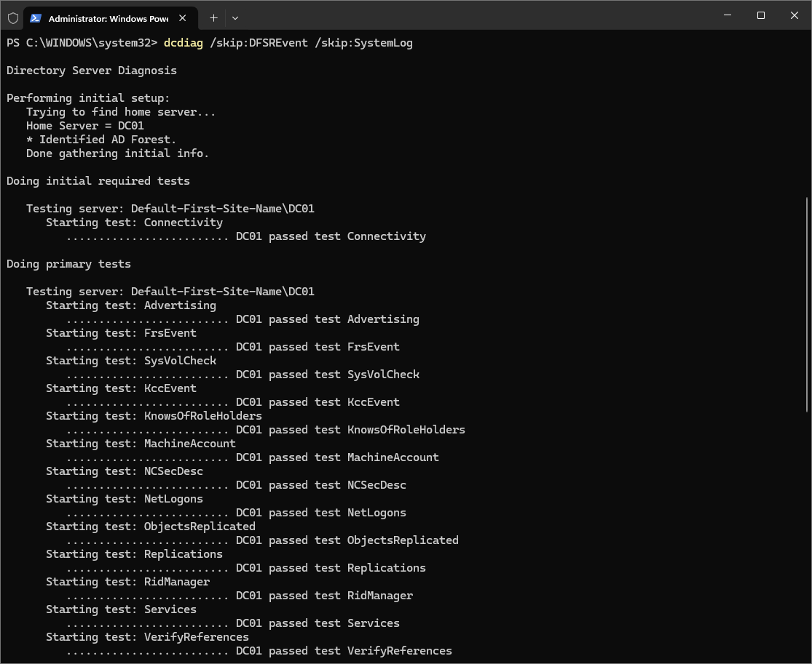
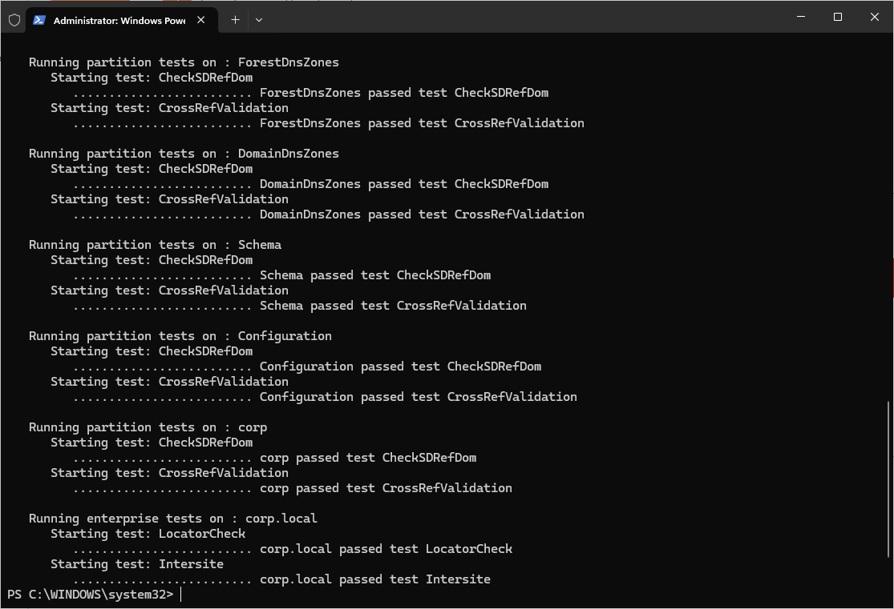
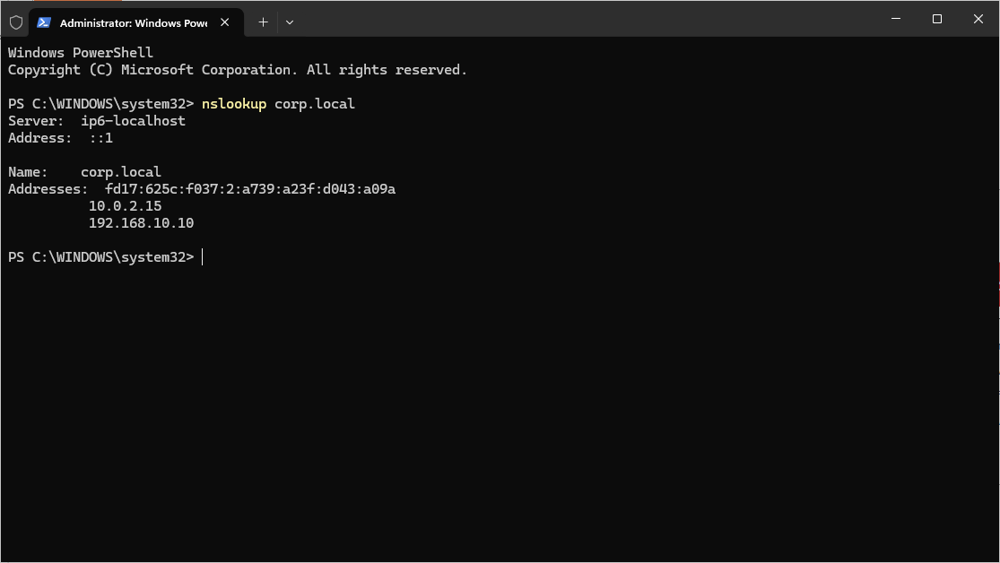
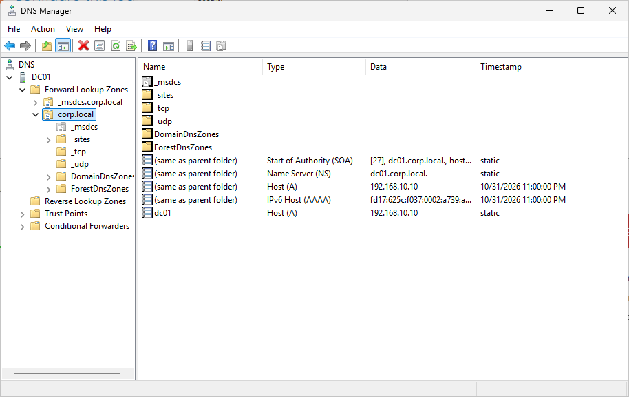
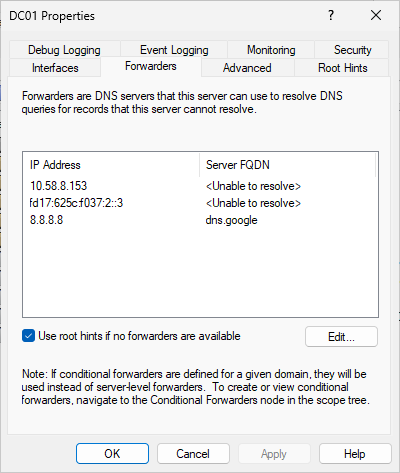
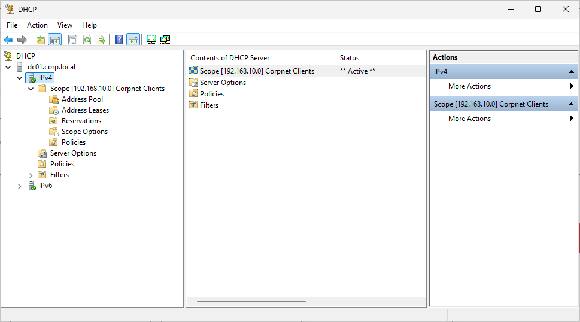
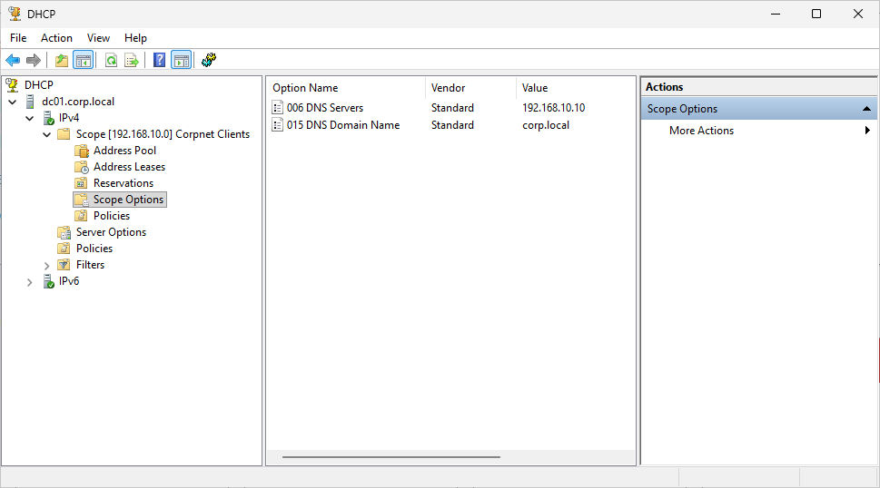
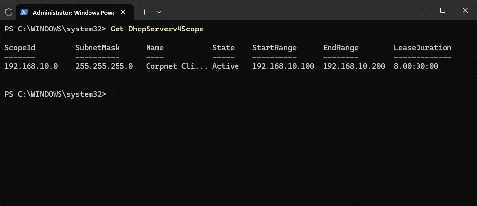

# Phase 3: Domain Controller, DNS and DHCP

## Goal

Turn the Windows Server VM (`DC01`) into the central controller of a small company network. By the end of this phase, DC01 runs Active Directory for the domain `corp.local`, answers DNS lookups, and hands out IP addresses to client PCs.

## What I built

| Item | Setting |
|---|---|
| Server | DC01 (Windows Server 2025, VirtualBox) |
| Domain | `corp.local` (NetBIOS name `CORP`) |
| Server IP (Corpnet) | 192.168.10.10 |
| DNS forwarder | 8.8.8.8 |
| DHCP scope | `Corpnet Clients`, 192.168.10.100 to 192.168.10.200 |
| DHCP options | DNS server 192.168.10.10, domain `corp.local` |

## Steps

1. Took a snapshot (`DC01 - pre-AD DS`) so I could roll back if the promotion went wrong.
2. Installed the **Active Directory Domain Services** and **DNS Server** roles.
3. Promoted DC01 to a domain controller in a new forest, `corp.local`, and set a DSRM recovery password. The server restarted on its own.
4. Stopped the NAT adapter from registering its address in DNS, and added a DNS forwarder (8.8.8.8) so the server can still resolve internet names.
5. Verified the domain controller (see Verification below). Snapshot: `DC01 - AD DS and DNS done`.
6. Installed the **DHCP Server** role and authorized it in Active Directory.
7. Created the `Corpnet Clients` scope and set the DNS server and domain name as scope options. No gateway, because this is an isolated lab network.
8. Checked the bindings: DHCP listens on the Corpnet adapter only. Snapshot: `DC01 - DHCP done`.

## Why

- **Active Directory** keeps one central list of users, computers and groups, so an account is created once and works on every joined PC. After promotion, my sign-in changed from a local account to `CORP\Administrator`, which shows this working.
- **DNS** has to live on the domain controller because clients find the domain by asking DNS where the DC is.
- **DNS registration:** DC01 has two adapters, and only the Corpnet address (192.168.10.10) is reachable by clients. Registering the NAT address too could send clients to the wrong place.
- **Forwarder:** the local DNS server only knows `corp.local`, so it passes other lookups (like `google.com`) on to 8.8.8.8.
- **DHCP** gives clients an address, the DNS server, and the domain name automatically. Authorizing it in AD stops unapproved DHCP servers from handing out addresses.
- **Snapshots** let me undo a bad change in seconds.

## Problems and fixes

**1. Promotion failed the prerequisites check**
- *Error:* "Role change is in progress or this computer needs to be restarted."
- *Cause:* a restart was still pending after installing the AD DS role.
- *Fix:* restarted DC01 and ran the promotion wizard again. It passed.

**2. `dcdiag` reported two failed tests**
- *What I saw:* `DFSREvent` and `SystemLog` failed.
- *Cause:* both tests fail on any recent event-log error. The errors were a Windows Update service stopping and a Secure Boot firmware notice, which doesn't apply to a VM. Neither is related to Active Directory.
- *Fix:* none needed. I re-ran `dcdiag` skipping those two tests, and everything else passed. `net share` also showed `SYSVOL` and `NETLOGON` shared.

**3. DNS server listed twice in the DHCP wizard**
- *What I saw:* `192.168.10.10` appeared twice on the DNS Servers page.
- *Fix:* removed the duplicate so it is listed once.

## Verification

Commands used:

```powershell
Get-ADDomain
dcdiag /skip:DFSREvent /skip:SystemLog
nslookup corp.local
Get-DhcpServerv4Scope
```

## Program walk-through:

### 1. Roles installed and running

<p align="center">
  <br>
  <em>Figure 1: Server Manager dashboard showing the AD DS, DHCP and DNS roles installed on DC01, all reporting as manageable</em>
</p>

<br>

### 2. Domain exists and DC01 runs it

<p align="center">
  <br>
  <em>Figure 2: Get-ADDomain shows the corp.local domain running on DC01</em>
</p>

<br>

### 3. Domain controller health

<p align="center">
  <br>
  <em>Figure 3: dcdiag, connectivity and primary tests all passed</em>
</p>

<br>

<p align="center">
  <br>
  <em>Figure 4: dcdiag, partition and enterprise tests on corp.local all passed</em>
</p>

<br>

### 4. DNS resolves the domain to the server

<p align="center">
  <br>
  <em>Figure 5: nslookup corp.local returns 192.168.10.10</em>
</p>

<br>

### 5. DNS zone and forwarder

<p align="center">
  <br>
  <em>Figure 6: DNS Manager showing the corp.local forward lookup zone and DC01 records</em>
</p>

<br>

<p align="center">
  <br>
  <em>Figure 7: DNS forwarder set to 8.8.8.8 for internet name resolution</em>
</p>

<br>

### 6. DHCP scope, options and status

<p align="center">
  <br>
  <em>Figure 8: The active Corpnet Clients scope (192.168.10.100 to 192.168.10.200)</em>
</p>

<br>

<p align="center">
  <br>
  <em>Figure 9: Scope options handing out the DNS server and corp.local domain name</em>
</p>

<br>

<p align="center">
  <br>
  <em>Figure 10: Get-DhcpServerv4Scope confirms the scope is active</em>
</p>

<br>

The scope shows 0 leases for now. Clients join in Phase 4, and that will be the real test of DHCP.

## What I learned

- A domain controller is a server with a special job, and Server Manager is just the dashboard used to manage it.
- Not every failed test means a real problem. Reading the actual error text is what separates noise from a fault.
- DNS, DHCP and Active Directory depend on each other, so the order of setup matters.

