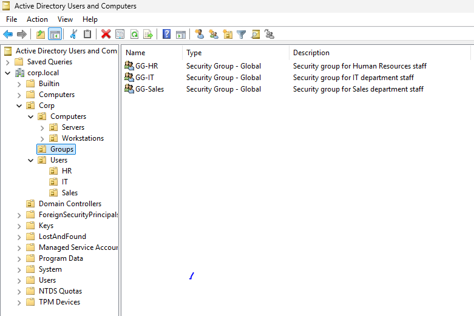
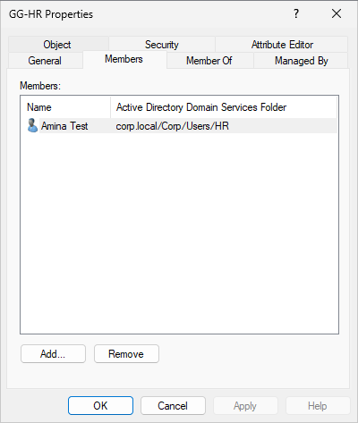
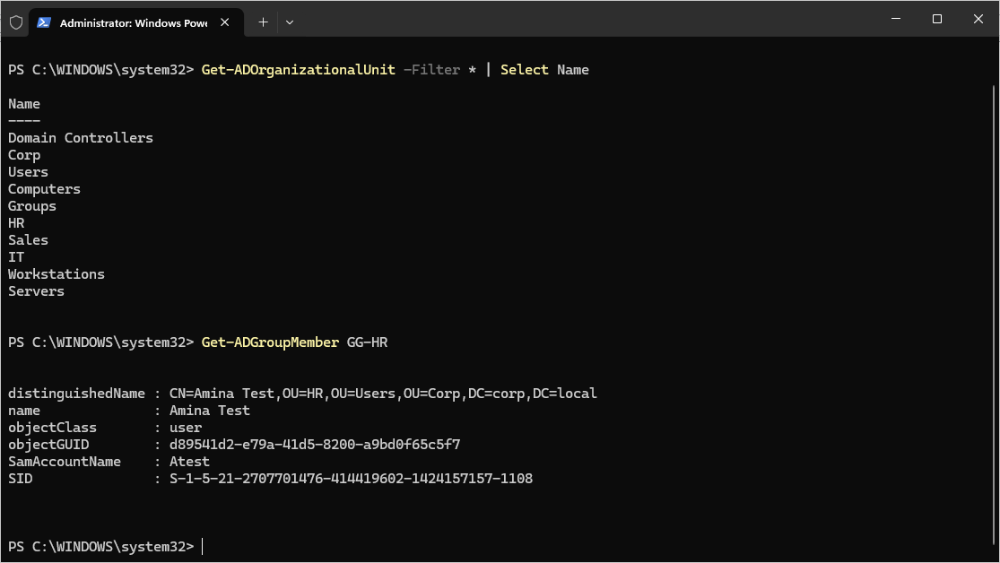
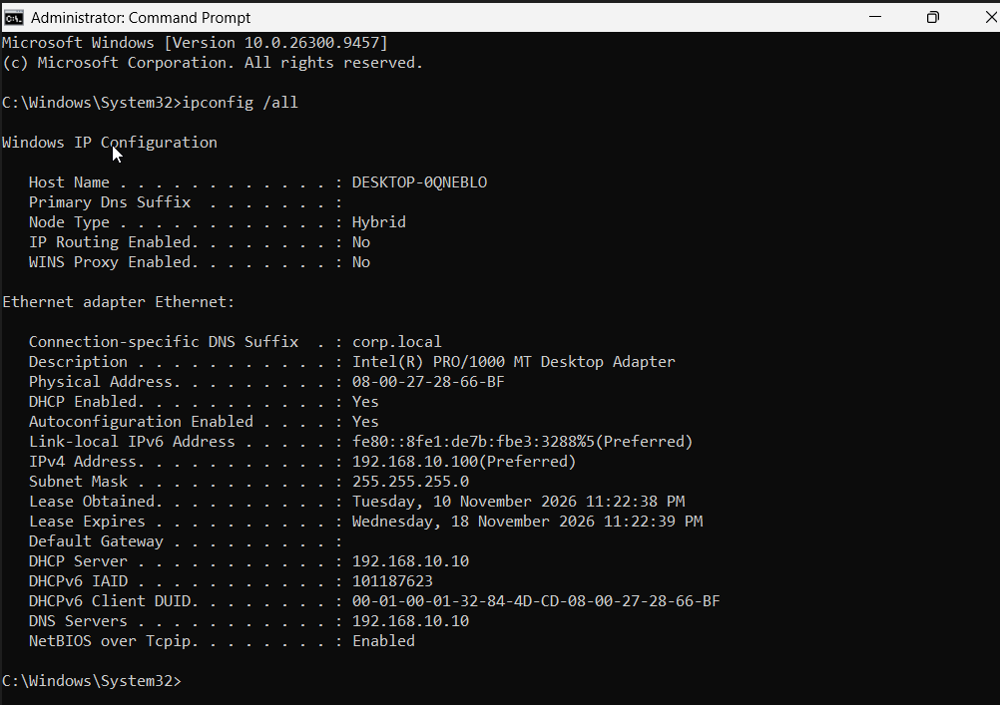
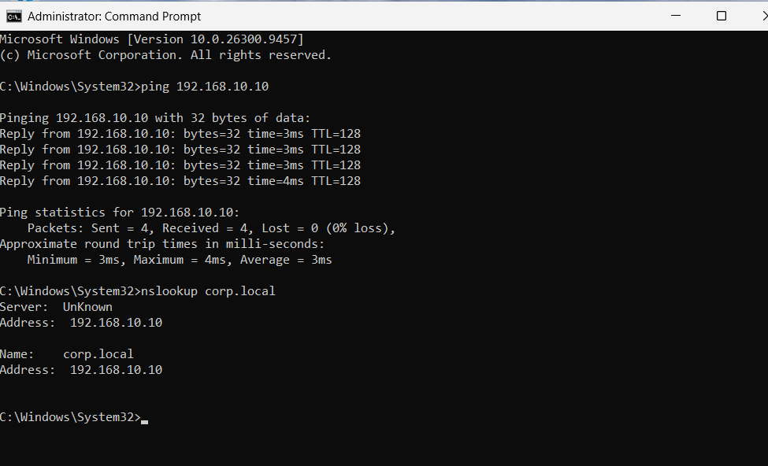
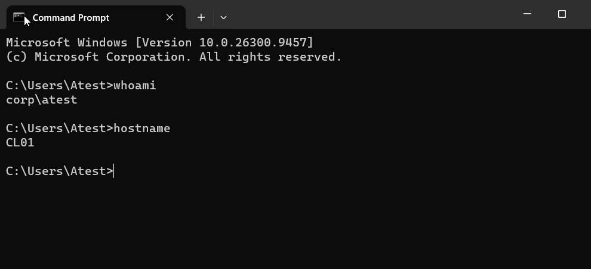
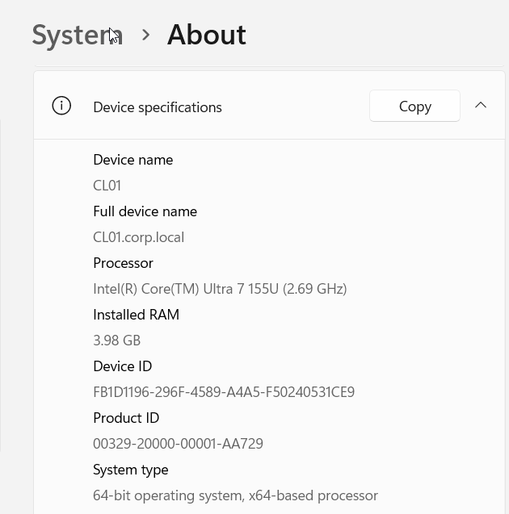
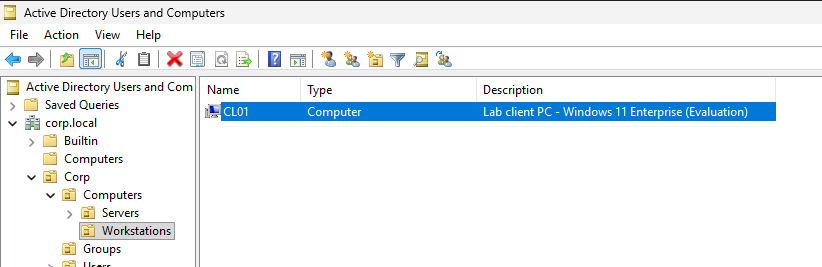

# Phase 4: Organizational Structure, Security Groups and Domain-Joined Client

> **Status:** Complete | **Domain:** `corp.local` | **Platform:** VirtualBox

| | |
|---|---|
| **Goal** | Model a small company in Active Directory (OUs, groups, users) and prove the domain works by joining a Windows 11 client. |
| **Servers / Clients** | `DC01` (Windows Server 2025, `192.168.10.10`) and `CL01` (Windows 11 Enterprise Evaluation) |
| **Network** | VirtualBox Internal Network `corpnet`, `192.168.10.0/24`, DHCP scope `192.168.10.100-200` |
| **Result** | Three departments, three security groups, three test users, and one client that receives DHCP, resolves DNS, and authenticates domain users. |

---

## 1. Design

The structure separates **users**, **computers** and **groups**, so that Group Policy (Phase 5) can target each department and device type independently.

```
corp.local
└── Corp
    ├── Users
    │   ├── HR
    │   ├── IT
    │   └── Sales
    ├── Computers
    │   ├── Workstations
    │   └── Servers
    └── Groups
```

| Test user | Logon name | Department OU | Security group |
|---|---|---|---|
| Amina Test | `atest` | HR | `GG-HR` |
| Ben Test | `btest` | IT | `GG-IT` |
| Chidi Test | `ctest` | Sales | `GG-Sales` |

**Naming convention:** the `GG-` prefix marks a **Global** security group, so a group's scope is clear from its name alone.

**Design decision:** OUs organize objects and receive policies; groups grant access to resources. Both are used so departments can be managed for policy *and* permissions.

---

## 2. Implementation: OUs, Groups and Users (DC01)

1. Opened **Active Directory Users and Computers** (Tools menu in Server Manager).
2. Created the `Corp` OU under `corp.local`, then the child OUs shown above, with **Protect from accidental deletion** left enabled.
3. Created three **Global** security groups in `Corp\Groups`: `GG-HR`, `GG-IT`, `GG-Sales`.
4. Created one test user per department OU (fake names and a lab-only password) and added each to the matching group.

<div align="center">
  
  <br>
  <sub><b>Figure 1.</b> The completed OU hierarchy and security groups in Active Directory Users and Computers. The <code>Corp</code> OU contains <code>Users</code> (with HR, IT and Sales), <code>Computers</code> (with Workstations and Servers) and <code>Groups</code>, which holds the three Global security groups <code>GG-HR</code>, <code>GG-IT</code> and <code>GG-Sales</code>, one per department.</sub>
</div>

<br>

<div align="center">
  
  <br>
  <sub><b>Figure 2.</b> The Members tab of <code>GG-HR</code>, confirming that the HR test user (Amina Test) has been added to her department group.</sub>
</div>

### Verification (PowerShell)

```powershell
Get-ADOrganizationalUnit -Filter * | Select Name
Get-ADGroupMember GG-HR
```

<div align="center">
  
  <br>
  <sub><b>Figure 3.</b> PowerShell confirming the configuration: the first command lists every OU created, and the second shows the members of <code>GG-HR</code>.</sub>
</div>

---

## 3. Implementation: Windows 11 Client (CL01)

1. Created the `CL01` VM (4 GB RAM, 2 CPUs, 64 GB disk) with a single network adapter on the Internal Network `corpnet`, so it can only communicate with `DC01`.
2. Installed Windows 11 Enterprise Evaluation (Home editions cannot join a domain) and the VirtualBox Guest Additions.
3. Confirmed that DHCP and DNS from Phase 3 work before joining the domain.
4. Joined the machine to `corp.local` using `sysdm.cpl` and restarted.
5. Signed in as a domain user, then moved the computer object into `Corp\Computers\Workstations`.

### Network verification

<div align="center">
  
  <br>
  <sub><b>Figure 4.</b> <code>ipconfig /all</code> on <code>CL01</code>. The client received an address from the DHCP scope (192.168.10.100-200), with DHCP server and DNS server both set to <code>192.168.10.10</code> and the connection suffix <code>corp.local</code>. This confirms the Phase 3 DHCP and DNS services work end to end.</sub>
</div>

<br>

<div align="center">
  
  <br>
  <sub><b>Figure 5.</b> Connectivity tests from <code>CL01</code>. <code>ping 192.168.10.10</code> returns replies from the domain controller, confirming network reachability, and <code>nslookup corp.local</code> resolves the domain to <code>192.168.10.10</code>, confirming DNS works. Both must succeed before a domain join can work.</sub>
</div>

### Domain join

<div align="center">
  
  <br>
  <sub><b>Figure 6.</b> The confirmation message displayed after joining <code>CL01</code> to the <code>corp.local</code> domain using the domain Administrator account.</sub>
</div>

<br>

<div align="center">
  
  <br>
  <sub><b>Figure 7.</b> After the restart, signing in as <code>CORP\atest</code>. <code>whoami</code> returns <code>corp\atest</code> and <code>hostname</code> returns <code>CL01</code>, proving that a domain account authenticates against <code>DC01</code>.</sub>
</div>

<br>

<div align="center">
  
  <br>
  <sub><b>Figure 8.</b> Settings &rarr; System &rarr; About showing the full device name <code>CL01.corp.local</code>, confirming the machine is a member of the domain.</sub>
</div>

### Computer placement

New computers land in the default `Computers` container, which cannot be targeted cleanly by Group Policy. `CL01` was moved into `Corp\Computers\Workstations` so Phase 5 policies can apply to it.

<div align="center">
  
  <br>
  <sub><b>Figure 9.</b> <code>CL01</code> listed inside the <code>Workstations</code> OU in Active Directory Users and Computers, ready to receive workstation Group Policy Objects.</sub>
</div>

---

## 4. Results

| Check | Evidence | Result |
|---|---|---|
| OU hierarchy built as designed | Figures 1, 3 | Pass |
| Security groups created (Global) | Figure 1 | Pass |
| Users assigned to correct groups | Figure 2 | Pass |
| Client receives DHCP and DNS settings | Figures 4, 5 | Pass |
| Client joined to `corp.local` | Figures 6, 8 | Pass |
| Domain user can sign in | Figure 7 | Pass |
| Client placed in target OU | Figure 9 | Pass |

---

## 5. Key Concepts

- **OU (Organizational Unit):** a container used to organize objects and to link Group Policy.
- **Security group:** a collection of accounts used to grant access to resources.
- **Domain join:** the process that makes a computer trust the domain controller for authentication.
- **Why DNS matters:** a client finds the domain controller through DNS records, so a client with the wrong DNS server cannot join.

---

## 6. Troubleshooting Reference

| Symptom | Likely cause | Fix |
|---|---|---|
| Client has a `169.254.x.x` address | DHCP not reaching the client | Check both VMs use the same internal network name (`corpnet`), the scope is activated, and DHCP is bound to the Corpnet adapter. Then run `ipconfig /release` and `ipconfig /renew`. |
| "Domain could not be contacted" | Client cannot resolve the domain | Confirm DNS is `192.168.10.10` and that `nslookup corp.local` succeeds. |
| Domain sign-in rejected | Wrong username format or password | Use `CORP\username`, or reset the password in ADUC. |
| Windows 11 setup blocks the install | VM lacks TPM 2.0 or EFI | Enable EFI and TPM 2.0 in VM settings. |

---

## 7. Next Step

**Phase 5: Group Policy.** Apply a wallpaper policy, a password and security baseline, and a software restriction to the OUs built here, and verify them from `CL01`.
