# Phase 5: Group Policy

> **Status:** Complete | **Domain:** `corp.local` | **Platform:** VirtualBox

| | |
|---|---|
| **Goal** | Secure and manage the domain with Group Policy, then prove each policy works from the Windows 11 client. |
| **Servers / Clients** | `DC01` (Windows Server 2025) and `CL01` (Windows 11 Enterprise Evaluation) |
| **Result** | Five policies built and tested: logon banner, password and lockout rules, USB block, department drive mapping, and sign-in auditing. |

---

## 1. Policies Built

I used one GPO per purpose, so each one can be tested or removed without touching the others.

| # | GPO | Linked to | What it does |
|---|---|---|---|
| 1 | `CMP-Workstation-Security` | Workstations OU | Logon banner, 10-minute screen lock, hides last signed-in user |
| 2 | Default Domain Policy | Domain | Password and account lockout rules |
| 3 | `CMP-USB-Block` | Workstations OU | Blocks all removable storage |
| 4 | `USR-Drive-Mapping` | Users OU | Maps department drives by security group |
| 5 | `DC-Audit-Policy` | Domain Controllers OU | Audits sign-in and account events |

Before each policy I took a snapshot of `DC01` and `CL01`, so I could roll back if something broke.

---

## 2. Logon Banner and Screen Lock

On `CMP-Workstation-Security` I set a legal banner (`AUTHORIZED USE ONLY`), a machine inactivity limit of 600 seconds, and enabled "Don't display last signed-in". After `gpupdate /force` and a restart, the banner appeared on `CL01` before sign-in.

  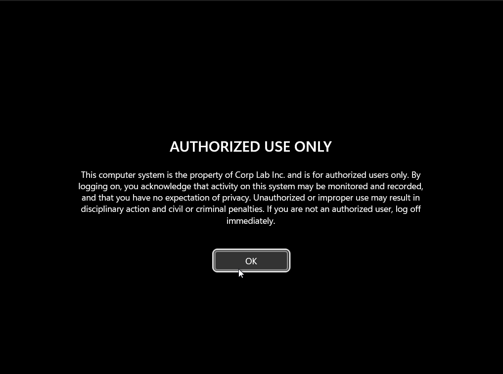
   
  <b>Figure 1.</b> The <code>AUTHORIZED USE ONLY</code> banner on <code>CL01</code> before sign-in.

 

  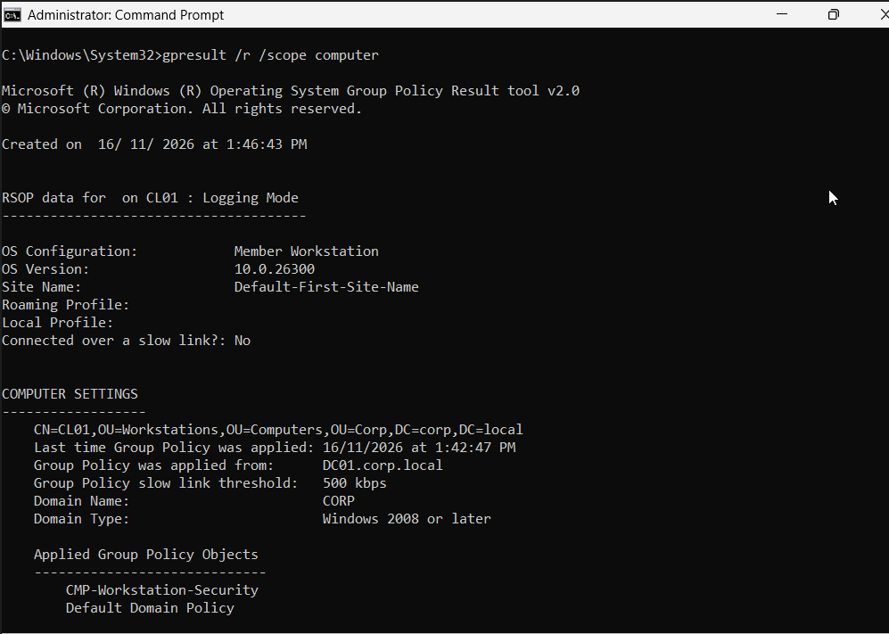
   
  <b>Figure 2.</b> <code>gpresult /r /scope computer</code> confirming the policy is applied to <code>CL01</code>.

 

---

## 3. Password and Account Lockout

I edited the Default Domain Policy, because password rules only apply when set at the domain level. To test it, I entered wrong passwords for `ctest` on `CL01` (never the Administrator), then unlocked it with `Unlock-ADAccount`.

  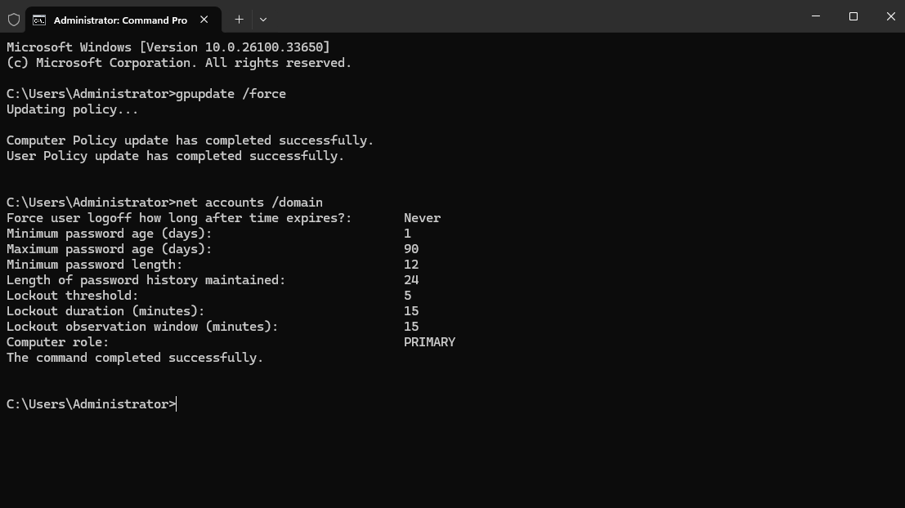
   
  <b>Figure 3.</b> <code>net accounts /domain</code> on <code>DC01</code> showing all the password and lockout values.

 

  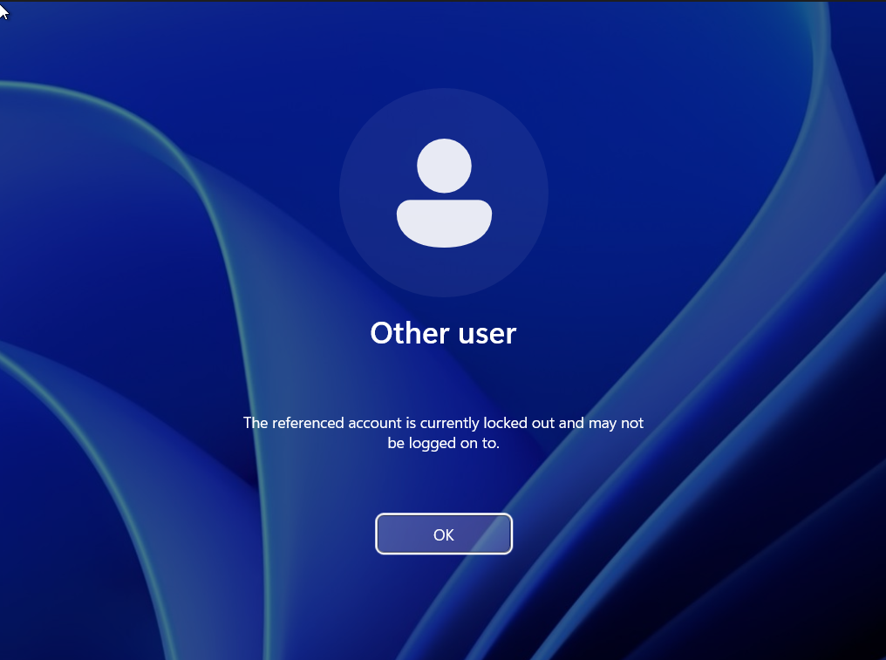
   
  <b>Figure 4.</b> The locked-out message on <code>CL01</code> after repeated wrong passwords.

 

---

## 4. USB Storage Block

On `CMP-USB-Block` I enabled **All Removable Storage classes: Deny all access**. After a restart, a USB drive attached to `CL01` was blocked.

  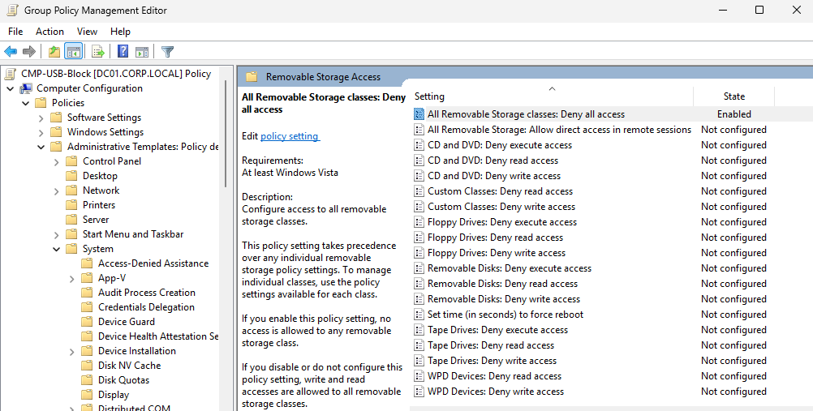
   
  <b>Figure 5.</b> The removable storage setting showing <b>Enabled</b> in <code>CMP-USB-Block</code>.

 

---

## 5. Department Drive Mapping

On `DC01` I created `HR`, `IT` and `Sales` shares. I removed Everyone and gave each share only its matching group (`GG-HR`, `GG-IT`, `GG-Sales`) Change access, plus Domain Admins Full Control. The NTFS permissions match the share permissions.

In `USR-Drive-Mapping` I mapped H:, I: and S:, and used item-level targeting so each user only gets the drive for their own group.

  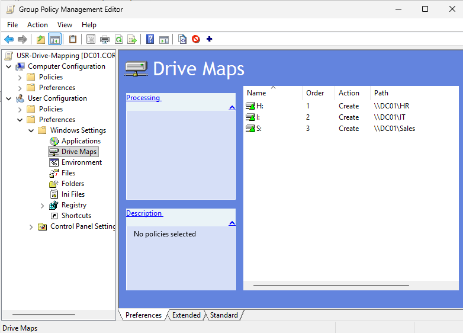
   
  <b>Figure 6.</b> The three drive maps (H:, I:, S:) in <code>USR-Drive-Mapping</code>.

 

  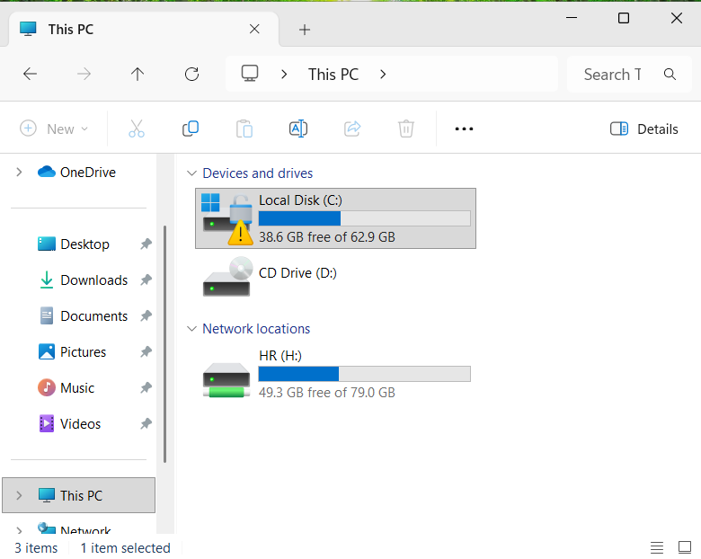
   
  <b>Figure 7.</b> <code>atest</code> (HR) sees only the HR drive (H:) in File Explorer.

 

  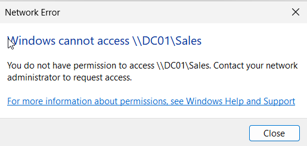
   
  <b>Figure 8.</b> <code>atest</code> gets access denied when opening <code>\\DC01\Sales</code>.

 

---

## 6. Audit Logon Events

On `DC-Audit-Policy` I enabled Success and Failure for Audit Logon, Audit Credential Validation, Audit Kerberos Authentication Service, and Audit User Account Management. Then I signed in on `CL01` once correctly and once with a wrong password, and checked the Security log on `DC01`.

  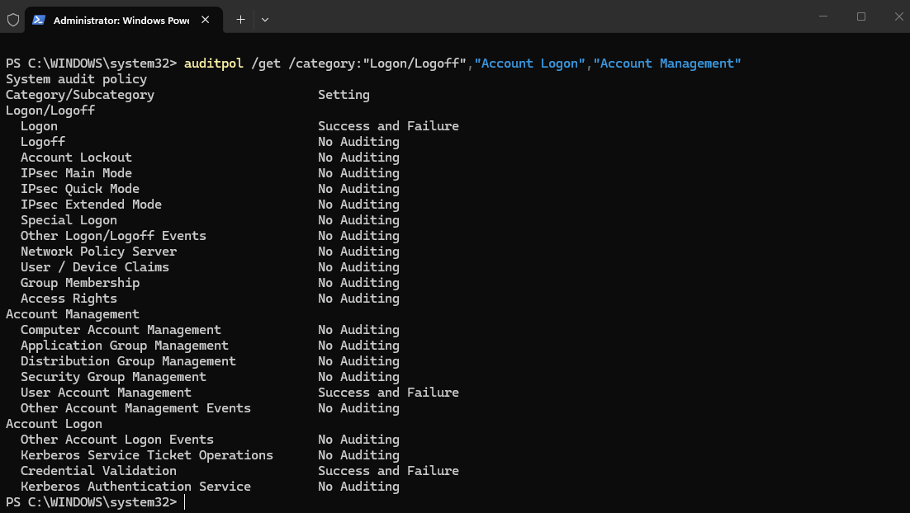
   
  <b>Figure 9.</b> <code>auditpol</code> on <code>DC01</code> confirming Success and Failure auditing.

 

  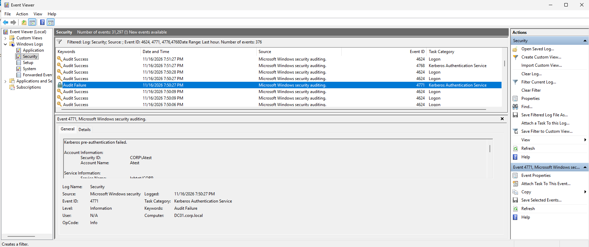
   
  <b>Figure 10.</b> Event Viewer showing a successful sign-in and a failed one (Event 4771).

 

  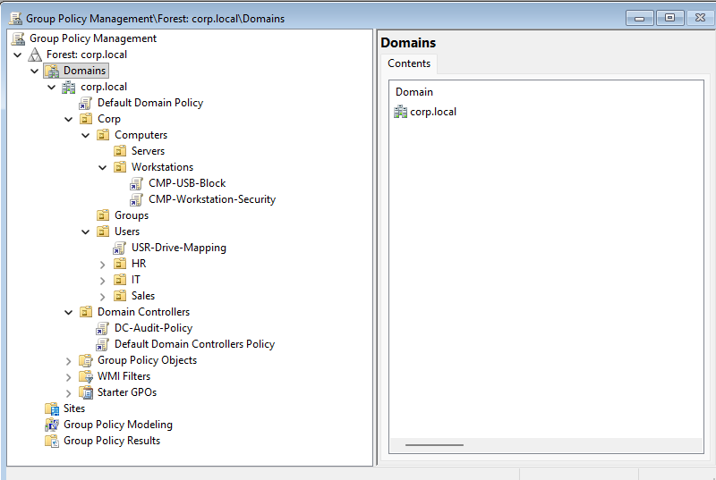
   
  <b>Figure 11.</b> All GPOs for this phase under Group Policy Objects.

 

---

## 7. Results

| Check | Evidence | Result |
|---|---|---|
| Logon banner shown before sign-in | Figures 1, 2 | Pass |
| Password and lockout rules applied | Figure 3 | Pass |
| Account locks after repeated wrong passwords | Figure 4 | Pass |
| USB storage blocked on `CL01` | Figure 5 | Pass |
| HR user sees only the HR drive | Figures 6, 7 | Pass |
| HR user denied on the Sales share | Figure 8 | Pass |
| Audit records success and failure | Figures 9, 10 | Pass |

---

## 8. Problems and Fixes

### Audit showed successes but no failures

After setting up the audit policy, I checked Event Viewer for the test account. I could see **Audit Success** events, but no **Audit Failure**, even though `auditpol` showed Success and Failure was enabled. It took me a few hours of research to solve.

**Cause:** under Group Policy Management, the Domain Controllers OU had two policies: mine (`DC-Audit-Policy`) and the one created by the system (Default Domain Controllers Policy). The system policy was higher in the link order, so its audit settings overrode mine.

**Fix:** I moved `DC-Audit-Policy` to **Link Order 1**, so it gets the highest priority, then ran `gpupdate /force` on `DC01`. After a new wrong-password attempt, the failure showed up as Event 4771.

**Lesson:** when a policy is set correctly but doesn't take effect, check the link order and which GPO wins.

### Yellow warning on the C: drive

On `CL01`, the C: drive showed a yellow warning on its icon. This is the BitLocker status icon. It is not related to my Group Policies, so I left it alone.

---

## 9. Key Concepts

- **GPO link order:** when several GPOs apply to the same OU, the lowest number wins. A conflicting setting in a higher-priority GPO overrides the others.
- **User vs computer policy:** computer settings apply at startup, user settings at sign-in. That is why drive maps need a sign-out and sign-in.
- **Share vs NTFS permissions:** both apply, and the stricter one wins, so I kept them matching.
- **Why audit:** sign-in logs show who signed in, when, and who failed.

---

## 10. Next Step

**Phase 6: PowerShell basics.** Learn variables, loops, `Import-Csv` and `New-ADUser`, ready to build the new-hire provisioning script.
