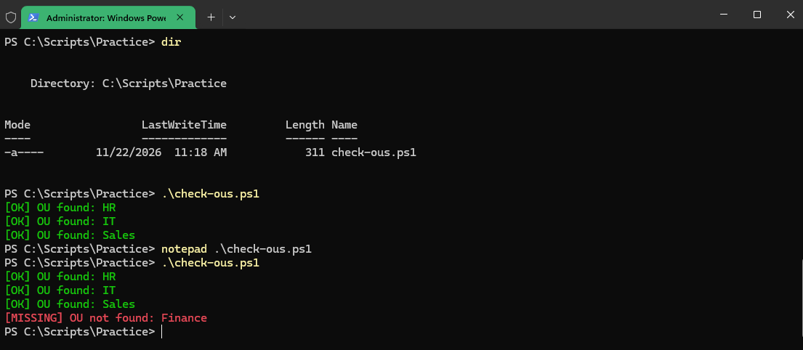
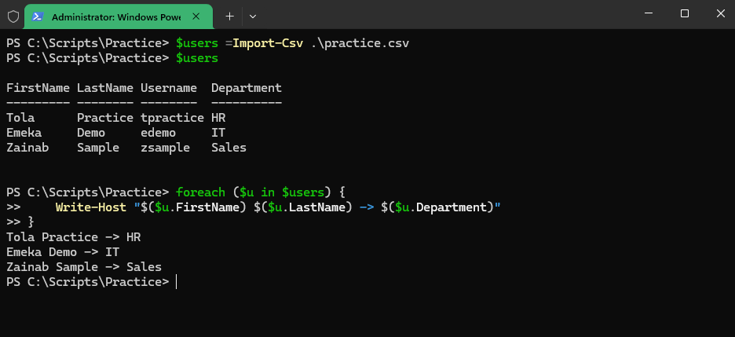
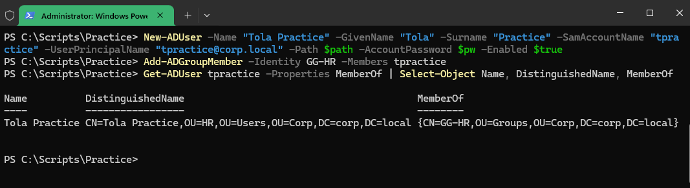
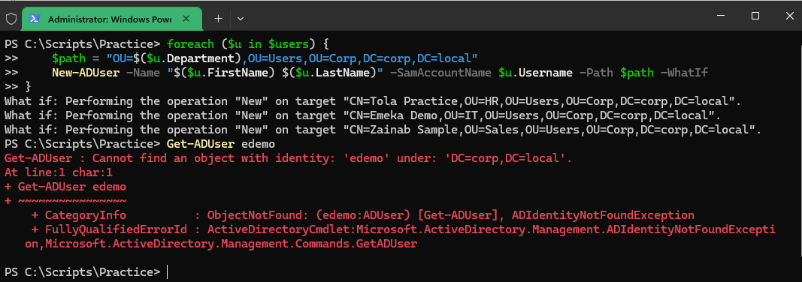
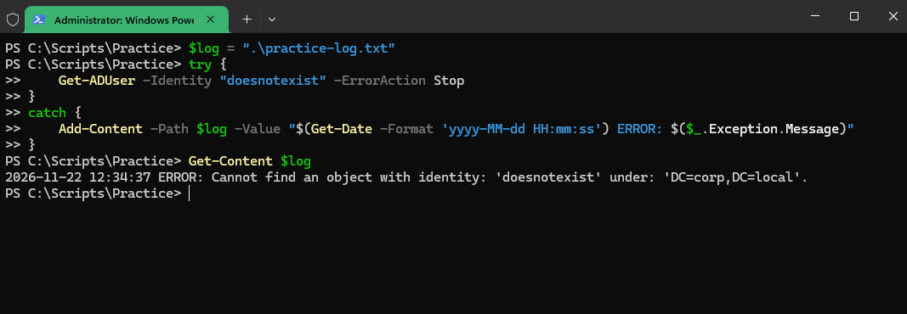

# Phase 6: PowerShell Fundamentals

> **Status:** Complete | **Environment:** DC01 (Windows Server 2025), `corp.local` | **Scripts:** `scripts/practice/`

## Goal

Learn the PowerShell building blocks I need for the Phase 7 provisioning script: reading data, looping, making decisions, creating AD users safely, and logging errors.

---

## Cheat Sheet

| Command | What it does |
|---|---|
| `Get-Help <cmdlet> -Examples` | Shows how a command works, with examples |
| `Where-Object` | Filters results to the items that match a condition |
| `foreach` | Repeats an action for each item in a list |
| `Import-Csv` | Reads a CSV file and turns each row into an object |
| `New-ADUser` | Creates a new Active Directory user account |
| `-WhatIf` | Previews what a command would do without running it |
| `try/catch` | Handles an error so the script keeps going and can log it |

---

## Practice Scripts

I practiced on DC01 using fake data only. The two files I wrote, `check-ous.ps1` and `practice.csv`, are in `scripts/practice/`.

  
   
  <b>Figure 1.</b> <code>check-ous.ps1</code> checks that the HR, IT and Sales OUs exist. Green means found, and the red line is Finance, which I added to test the <code>else</code> branch.

 

  
   
  <b>Figure 2.</b> <code>Import-Csv</code> turns each column into a property, and the loop prints every new hire with their department.

 

  
   
  <b>Figure 3.</b> A test user created with <code>New-ADUser</code> and added to <code>GG-HR</code>. The output confirms the account sits in the HR OU and is a member of the group.

 

  
   
  <b>Figure 4.</b> A dry run of <code>New-ADUser</code> for all three CSV rows. <code>-WhatIf</code> shows what would happen without creating any accounts.

 

  
   
  <b>Figure 5.</b> <code>try/catch</code> caught a failed user lookup and wrote a timestamped entry to <code>practice-log.txt</code> instead of crashing.

 

---

## What I Learned

PowerShell is much easier to read once you notice the Verb-Noun pattern. The pipeline, loops and `Import-Csv` are what make onboarding automation possible, because one loop can replace a lot of clicking in Active Directory Users and Computers. `-WhatIf` and `try/catch` are habits I'll keep, since they make a script safer to run and easier to troubleshoot.

---

## Next Step

**Phase 7:** build the full provisioning script that reads a new-hire CSV, creates accounts, assigns groups, provisions home folders, and logs every action.
